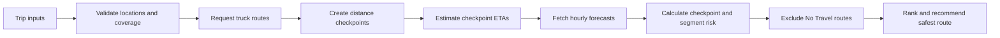
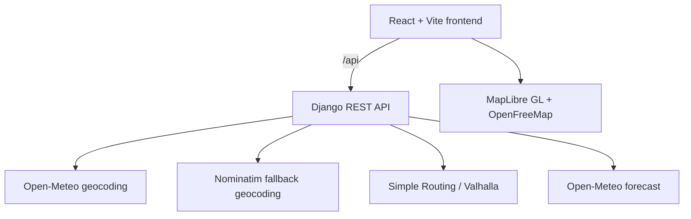

# WeatherRoute

WeatherRoute is a full-stack weather-aware truck routing application. It compares available truck routes, estimates when the vehicle will reach checkpoints along each route, evaluates the forecast at those ETAs, and recommends the safest viable option.

The application is designed to help dispatchers answer a practical question: **which route offers the best balance of weather safety and travel time for this truck and departure?**

## Submission links

| Deliverable | Link |
| --- | --- |
| Source repository | [Truck Routing Based On Weather](https://github.com/pheonix666999/Truck-Routing-Based-On-Weather) |
| Live application | Add the deployed application URL before submission |
| Video walkthrough | Add the 5–10 minute Loom URL before submission |

## Features

- City and country autocomplete for origin and destination.
- Routing-graph coverage checks before planning. Unsupported locations display an inline error and cannot be submitted.
- Truck-route planning with a primary route and up to two alternatives.
- Configurable weather checkpoints every 10, 25, or 50 miles.
- ETA calculation for every checkpoint based on route distance and travel time.
- Hourly wind, rain, and snowfall forecasts matched to each checkpoint ETA.
- Load-aware weather risk classification: Low, Moderate, High, Severe, or No Travel.
- Route ranking that prioritizes safety before travel time.
- Automatic exclusion of routes containing No Travel segments.
- Interactive MapLibre map showing all returned routes and weather checkpoints.
- ETA risk mode with road segments colored by forecast severity.
- Corridor forecast mode with a playable 0–48 hour timeline.
- Detailed checkpoint conditions and risk breakdowns.
- Responsive planning panel and map layout for desktop, tablet, and mobile screens.
- Structured validation and service-error messages while preserving the previous successful result.

## How route analysis works



The routing request asks the provider for a primary truck route and two alternatives. Each route is divided at the selected checkpoint interval. Checkpoint ETAs are calculated from cumulative route distance, then matched to the first available hourly forecast at or after arrival, provided it is less than one hour away.

Each road interval uses the higher risk of its two endpoint checkpoints. This same rule is used by both the backend mileage summary and the map visualization.

### Weather thresholds

| Risk | Wind | Rain | Snowfall |
| --- | ---: | ---: | ---: |
| Low | `< 25 mph` | `< 0.10 in/hr` | `< 0.5 in/hr` |
| Moderate | `25–34 mph` | `0.10–0.24 in/hr` | `0.5–0.99 in/hr` |
| High | `35–44 mph` | `0.25–0.49 in/hr` | `1.0–1.99 in/hr` |
| Severe | `45–54 mph` | `0.50–1.00 in/hr` | `2.0–3.0 in/hr` |
| No Travel | `≥ 55 mph` | `> 1.00 in/hr` | `> 3.0 in/hr` |

Wind risk also accounts for truck load:

- Winds from 45–54 mph become No Travel when the load is over 30,000 lb.
- Winds from 35–44 mph become Severe when the load is over 40,000 lb.
- Winds of 55 mph or higher are always No Travel.

The overall checkpoint risk is the highest of its wind, rain, and snowfall risks.

### Recommendation order

Routes containing No Travel mileage are excluded from recommendation. Remaining routes are sorted by:

1. Fewest Severe miles.
2. Fewest High-risk miles.
3. Lowest distance-weighted average risk.
4. Shortest travel time.

## Architecture and services



| Layer | Technology |
| --- | --- |
| Frontend | React 19, Vite, MapLibre GL, Lucide React |
| Backend | Python, Django 6, Django REST Framework |
| Routing | Simple Routing / Valhalla truck routing |
| Forecasts | Open-Meteo hourly forecast API |
| Search | Open-Meteo geocoding, with Nominatim fallback for unselected text input |
| Map | OpenFreeMap tiles rendered with MapLibre GL |
| Testing | Django test runner, Vitest, Testing Library, Playwright browser checks |

The backend batches all checkpoint coordinates for a route into one forecast request. Location searches and routing-coverage results are cached for one hour, while raw weather series are cached for 15 minutes. Transient network, rate-limit, and server failures use bounded retries; interactive autocomplete does not retry so stale searches return quickly.

## Project structure

```text
Weather-Routing/
├── backend/
│   ├── config/                 # Django configuration
│   ├── routing/                # API, routing, weather, risk and ranking logic
│   ├── manage.py
│   └── requirements.txt
├── frontend/
│   ├── src/
│   │   ├── api/                # Backend API client
│   │   ├── components/         # Form, map, route and forecast UI
│   │   ├── hooks/              # Trip-planning state
│   │   └── utils/              # Map geometry and risk helpers
│   ├── browser-check.mjs       # Responsive end-to-end browser checks
│   └── package.json
└── README.md
```

## Local setup

### Prerequisites

- Python 3.12 or newer.
- Node.js 22.12 or newer.
- npm.
- A Simple Routing API key.
- Internet access for routing, geocoding, weather, map styles, and tiles.

### 1. Configure and start the backend

From the repository root in PowerShell:

```powershell
python -m venv backend/venv
backend/venv/Scripts/python.exe -m pip install -r backend/requirements.txt
```

Create `backend/.env`:

```dotenv
SIMPLE_ROUTING_API_KEY=your_simple_routing_api_key
NOMINATIM_USER_AGENT=WeatherRoute/1.0 your-email@example.com
DJANGO_DEBUG=True
```

The Nominatim user agent must identify the application and include a valid contact. Do not expose these values through Vite or commit the `.env` file.

Start Django:

```powershell
backend/venv/Scripts/python.exe backend/manage.py migrate
backend/venv/Scripts/python.exe backend/manage.py runserver 127.0.0.1:8000
```

### 2. Install and start the frontend

In a second PowerShell terminal:

```powershell
npm --prefix frontend ci
npm --prefix frontend run dev -- --host 127.0.0.1
```

Open [http://127.0.0.1:5173](http://127.0.0.1:5173). During local development, Vite proxies `/api` requests to Django on port 8000.

## API endpoints

| Method | Endpoint | Purpose |
| --- | --- | --- |
| `GET` | `/api/health/` | Backend health check |
| `GET` | `/api/locations/?q=...` | Autocomplete city and country search |
| `GET` | `/api/coverage/?lat=...&lon=...` | Check whether coordinates are on the routing graph |
| `POST` | `/api/plan/` | Generate, analyze, rank, and return route alternatives |

Example planning request:

```json
{
  "origin": "Chicago, Illinois, USA",
  "origin_lat": 41.8781,
  "origin_lon": -87.6298,
  "destination": "Detroit, Michigan, USA",
  "destination_lat": 42.3314,
  "destination_lon": -83.0458,
  "departure_time": "2026-11-15T12:00:00Z",
  "load_weight": 42000,
  "checkpoint_interval": 25
}
```

The plan response contains every returned route, decoded geometry, checkpoint ETAs and conditions, risk summaries, 49 corridor forecast timestamps, hourly checkpoint risks, ranked safe routes, excluded routes, and the recommended route ID.

## Validation and error handling

The API returns JSON errors with an appropriate HTTP status for:

- Missing, malformed, or out-of-range request fields.
- Incomplete coordinate pairs.
- Unknown locations and locations outside routing coverage.
- Routes the provider cannot calculate.
- Geocoding, routing, or forecast service outages.
- Missing forecast hours or arrivals outside forecast coverage.
- Malformed external-service responses.
- Unexpected processing failures.

Detailed exceptions are logged on the server without returning credentials or stack traces to the browser. The frontend cancels stale autocomplete, coverage, and planning requests; it also retains the last successful plan when a later request fails.

## Testing and verification

Run the automated checks from the repository root:

```powershell
npm --prefix frontend run lint
npm --prefix frontend test
npm --prefix frontend run build
backend/venv/Scripts/python.exe backend/manage.py test routing
backend/venv/Scripts/python.exe backend/test_risk.py
backend/venv/Scripts/python.exe backend/test_weather_eta.py
backend/venv/Scripts/python.exe backend/test_ranking.py
backend/venv/Scripts/python.exe backend/test_route_ranking.py
```

With the frontend development server running and Chrome installed:

```powershell
node frontend/browser-check.mjs
```

The browser check uses deterministic API fixtures and a blank map style. It verifies planning, route selection, checkpoint inspection, forecast playback, panel collapse, autocomplete, unsupported-location feedback, API request counts, and horizontal overflow at these viewports:

- 1920×1080
- 1366×768
- 1024×768
- 768×1024
- 1440×1000
- 390×844
- 320×568

Current verification result: 15 frontend tests, 14 Django tests, all deterministic risk/ranking scripts, lint, production build, and all seven browser viewports pass.

## Production configuration

`VITE_API_BASE_URL` can point the frontend build to a separately hosted backend. Leave it unset when the frontend and API share an origin or a reverse proxy handles `/api`.

Before deploying Django:

- Set `DJANGO_SECRET_KEY` to a long, unique, unpredictable value.
- Set `DJANGO_DEBUG=False` or leave it unset; production defaults to `False`.
- Set `DJANGO_ALLOWED_HOSTS` to a comma-separated list of deployed hostnames.
- Configure trusted origins when required by the hosting environment.
- Serve Django with a production WSGI or ASGI server.
- Use a shared cache when running multiple backend workers.
- Configure CORS only when the frontend and backend use separate origins.
- Keep all provider credentials on the backend.

Collect the Django admin and other backend static assets during deployment:

```powershell
backend/venv/Scripts/python.exe backend/manage.py collectstatic --noinput
```

WhiteNoise serves the collected, compressed, content-hashed files from `backend/staticfiles`.

Build the frontend with:

```powershell
npm --prefix frontend run build
```

Deploy `frontend/dist` as static files and deploy the Django backend separately. No hosting infrastructure is included in this repository.

## Known limitations

- Valhalla may return fewer than three routes when it cannot find three materially distinct truck alternatives. The interface shows every valid route returned and never fabricates duplicates.
- Forecasts are predictions sampled at checkpoints, not observations at every road coordinate.
- The risk model does not include wind gusts, road closures, traffic, pavement conditions, bridge restrictions, or every jurisdiction-specific trucking rule.
- Departures must be within the next five days, and the full trip must remain within available forecast coverage.
- Map rendering requires WebGL and access to external map tiles.
- The MapLibre bundle produces a non-blocking Vite bundle-size advisory.

WeatherRoute is a decision-support tool and should not replace official weather alerts, road closures, carrier policies, or driver judgment.

## Data attribution

- Maps: [OpenFreeMap](https://openfreemap.org/), [OpenMapTiles](https://openmaptiles.org/), and [OpenStreetMap contributors](https://www.openstreetmap.org/copyright).
- Weather and autocomplete: [Open-Meteo](https://open-meteo.com/) (CC BY 4.0).
- Fallback geocoding: [Nominatim](https://nominatim.org/) and OpenStreetMap contributors.
- Routing: Simple Routing / Valhalla.

Map attribution remains visible in the application.
